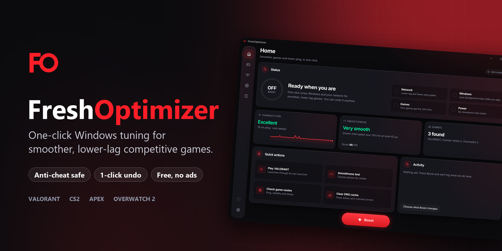
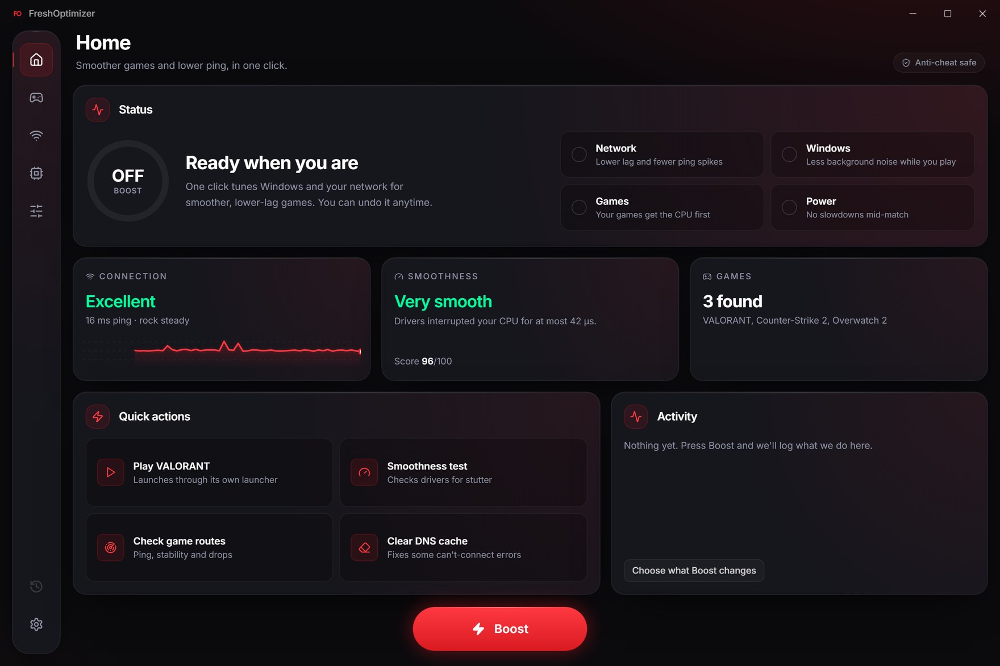
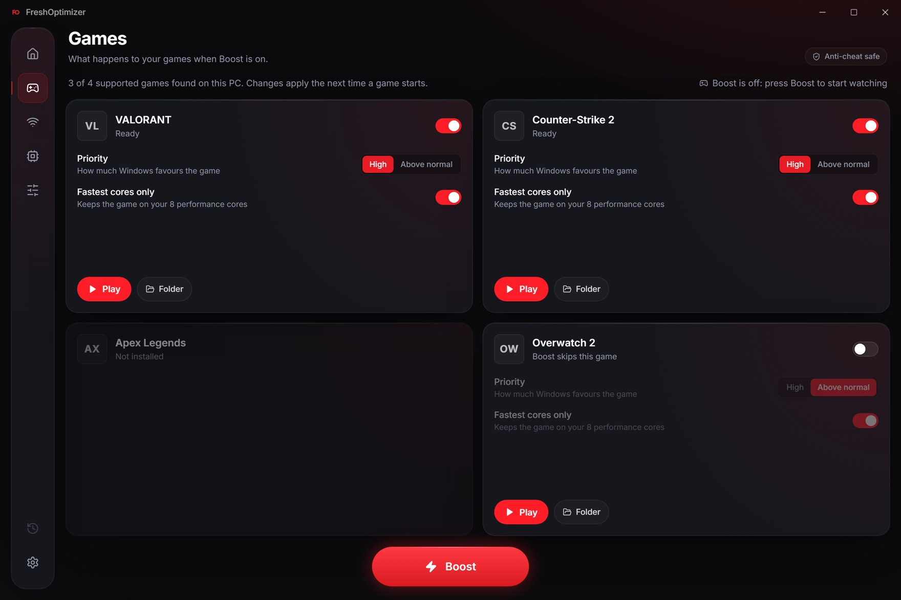
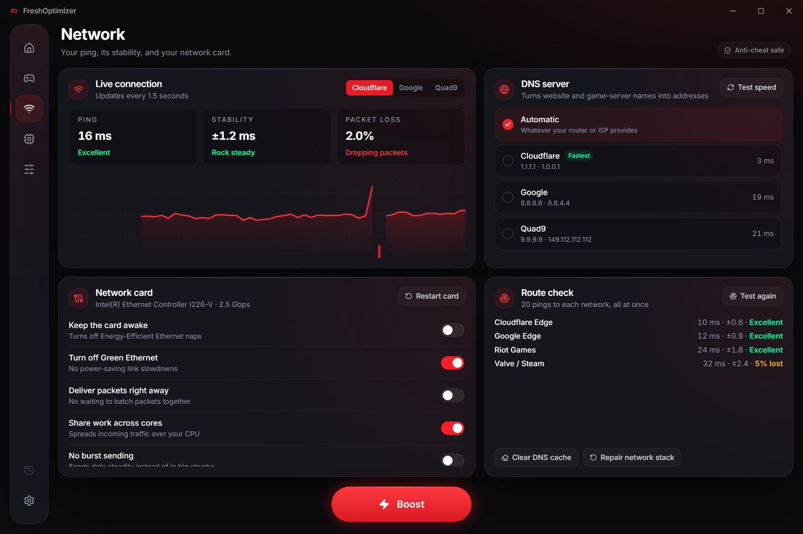
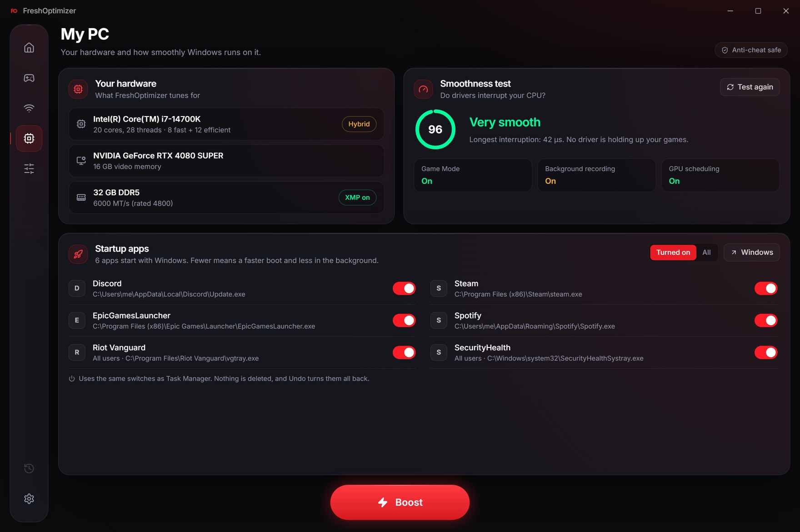
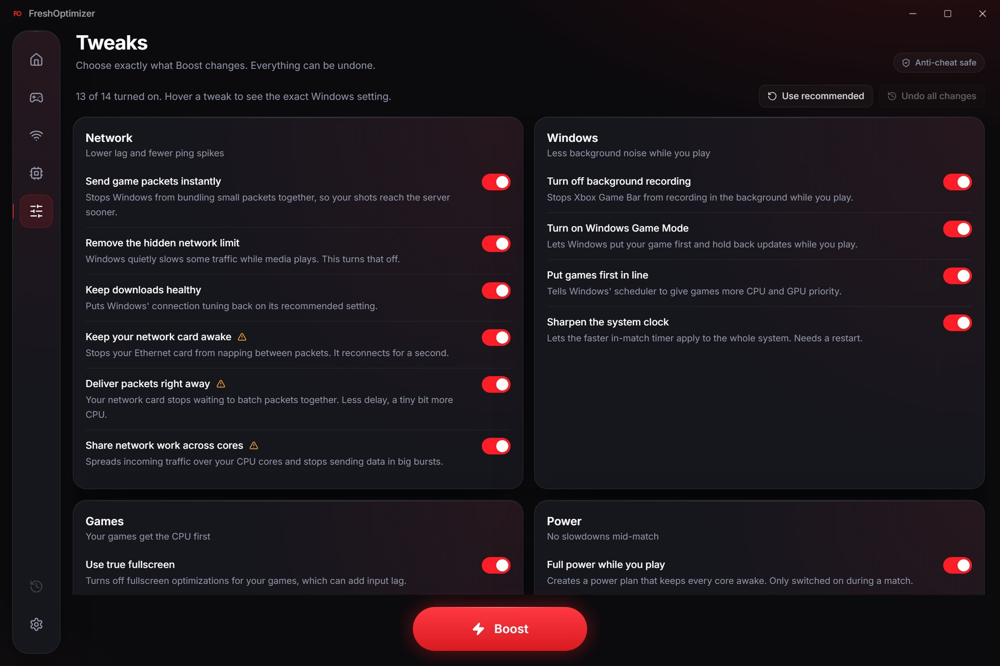
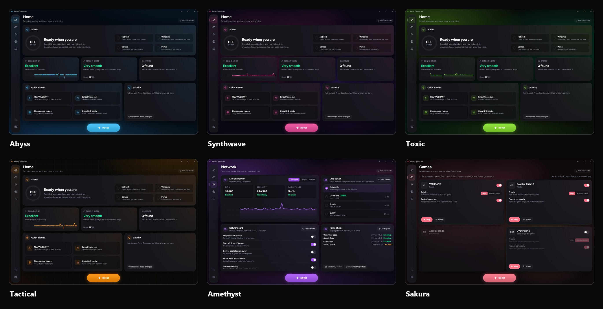
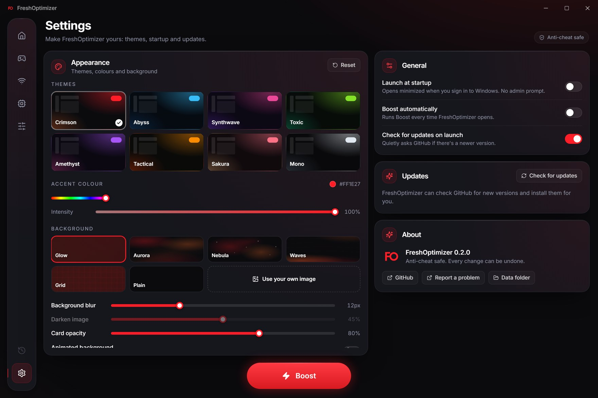

<div align="center">



<br />

<a href="https://github.com/mohibk0004-del/fresh-optimizer/releases/latest"></a>


<h3>Smoother frames. Lower ping. One button.</h3>

<p>FreshOptimizer tunes Windows, your network card and your power plan for <b>VALORANT</b>, <b>Counter-Strike 2</b>, <b>Apex Legends</b> and <b>Overwatch 2</b>,<br/>then switches to full power the moment a match starts. Every change is recorded first, and one click puts it all back.</p>

<a href="https://github.com/mohibk0004-del/fresh-optimizer/releases/latest"><b>Download for Windows</b></a>
&nbsp;·&nbsp;
<a href="#-features">Features</a>
&nbsp;·&nbsp;
<a href="#-themes">Themes</a>
&nbsp;·&nbsp;
<a href="#-safety">Safety</a>
&nbsp;·&nbsp;
<a href="#-build-from-source">Build</a>

</div>

<br />

## ⚡ Get started in 30 seconds

1. **Download** `FreshOptimizer-Setup.exe` from the [latest release](https://github.com/mohibk0004-del/fresh-optimizer/releases/latest).
2. **Install.** One click. It lands in Program Files with a Start menu shortcut.
3. **Press Boost.** Then launch your game. FreshOptimizer notices and goes full power automatically.

> [!NOTE]
> The installer isn't code-signed yet, so Windows SmartScreen may say *"Windows protected your PC"*. Click **More info → Run anyway**. FreshOptimizer asks for administrator rights because network-card and power settings require them.

<br />

## ✨ Features

<table>
<tr>
<td width="50%" valign="top">

### 🏠 One-click Boost
Fourteen hand-picked tweaks across your network, Windows, games and power plan, applied in seconds with a live checklist. Plain-English names, with the exact Windows setting one hover away.

### 🎮 Match mode, automatic
When a supported game starts: **high priority**, your **fastest cores** on hybrid Intel CPUs, a **0.5 ms system timer** and a **low-latency power plan**. When it closes, everything goes back to normal.

### 🌐 Network & packet guard
Live ping, stability and packet-loss graph. Route check against Cloudflare, Google, Riot and Valve. **DNS switcher** with real latency per server. Network-card power saving, interrupt moderation, RSS and LSO as simple switches.

</td>
<td width="50%" valign="top">

### 💻 Know your PC
CPU, GPU and memory at a glance, an **XMP/EXPO check**, and a **smoothness test** that catches drivers stealing your CPU (the cause of most micro-stutter).

### 🚀 Startup apps manager
See everything that starts with Windows and switch it off with one tap. Uses the same switches as Task Manager, so nothing is ever deleted.

### 🎨 Make it yours
Eight themes, a custom accent colour, built-in wallpapers or **your own image** with blur and glass controls. Launch at startup, auto-boost and **in-app updates**.

</td>
</tr>
</table>

<br />

<div align="center">

<sub><b>Home</b>: one status, three plain answers, quick actions.</sub>
</div>

<br />

<table>
<tr>
<td width="50%"><p align="center"><sub><b>Games</b>: per-game boost, priority, fastest cores and a Play button that launches through Steam, Riot or Battle.net.</sub></p></td>
<td width="50%"><p align="center"><sub><b>Network</b>: live ping graph, DNS switcher, network-card switches and route check.</sub></p></td>
</tr>
<tr>
<td width="50%"><p align="center"><sub><b>My PC</b>: hardware, smoothness test, Windows gaming settings and startup apps.</sub></p></td>
<td width="50%"><p align="center"><sub><b>Tweaks</b>: choose exactly what Boost changes. Every switch explains itself.</sub></p></td>
</tr>
</table>

<br />

## 🎨 Themes

Pick a preset, dial in your own accent colour, or drop in a wallpaper and let the glass show it through. The whole app re-themes instantly.

<div align="center">

</div>

<details>
<summary><b>Settings page</b></summary>
<br />

</details>

<br />

## 🛡️ Safety

FreshOptimizer is built to be boring where it matters.

| | |
|---|---|
| **Anti-cheat safe** | No DLL injection, no reading or writing game memory, no hooks, no drivers, no "RAM cleaners". Game processes are only opened with *set priority* rights. If an anti-cheat blocks even that (Vanguard may), FreshOptimizer falls back to a launch-time priority setting that Windows applies itself. |
| **Everything is undoable** | Before any change, the original value is saved to a restore point. **Undo all changes** puts back registry values, network-card settings, DNS, TCP tuning, startup apps and your power plan, in reverse order. |
| **Clean uninstall** | The uninstaller can restore your original Windows settings before it removes the app, its shortcuts and its startup task. |
| **Updates from one place** | In-app updates only ever download from this repository's GitHub Releases. |
| **No telemetry** | No accounts, no analytics, no ads. The only network traffic is pings you can see on screen and the optional update check. |

<br />

## 🔧 What Boost changes

<details>
<summary><b>The full list</b> (every item can be switched off on the Tweaks page)</summary>
<br />

| Area | Tweak | Windows setting |
|---|---|---|
| Network | Send game packets instantly | `TcpAckFrequency=1`, `TCPNoDelay=1` on the active adapter |
| Network | Remove the hidden network limit | `NetworkThrottlingIndex=0xFFFFFFFF` |
| Network | Keep downloads healthy | `netsh int tcp set global autotuninglevel=normal` |
| Network card | Keep your network card awake | Energy-Efficient / Green Ethernet off |
| Network card | Deliver packets right away | Interrupt Moderation off |
| Network card | Share network work across cores | RSS on, Large Send Offload off |
| Windows | Turn off background recording | Game DVR / Xbox capture off |
| Windows | Turn on Windows Game Mode | `AutoGameModeEnabled=1` |
| Windows | Put games first in line | MMCSS *Games* task: High priority, GPU priority 8 |
| Windows | Sharpen the system clock | `GlobalTimerResolutionRequests=1` (Windows 11) |
| Games | Use true fullscreen | Fullscreen optimizations off per game executable |
| Games | Start games at high priority | IFEO `PerfOptions\CpuPriorityClass=3` |
| Power | Full power while you play | "FO Low-DPC" plan: no core parking, 100 % minimum state, PCIe/USB power saving off, active only in-match |
| Power | Never let the CPU rest *(off by default)* | Processor idle states disabled in-match |

</details>

<br />

## 🏗️ Build from source

**Requirements:** Windows 10/11, [Node.js 20+](https://nodejs.org), [Rust](https://rustup.rs) (stable, MSVC), WebView2 runtime.

```bash
npm install
npm run dev        # UI in the browser with demo data
npx tauri dev      # the real app (run from an elevated terminal)
npm run dist       # release build + installer -> release/FreshOptimizer-Setup-<version>.exe
```

`cargo test --lib` in `src-tauri/` runs read-only hardware probes and a sandboxed registry backup and rollback test.

<details>
<summary><b>Architecture</b></summary>
<br />

| | Stack |
|---|---|
| **App** | Tauri 2 · React 19 · TypeScript · Tailwind · Framer Motion |
| **Core** | Rust · Win32 (`windows-sys`) · registry (`winreg`) · `netsh` · `powercfg` · NetAdapter / DnsClient PowerShell |
| **Installer** | Custom Tauri setup app (`setup/`): compressed payload, Program Files install, Windows *Apps* registration, self-copying uninstaller |

| Module | What it does |
|---|---|
| `restore.rs` | Restore point (`RestorePoint.json`): baseline saved before every write, persisted atomically, replayed in reverse on undo |
| `registry.rs` | Tracked registry writes; undo restores the raw value or removes it and any keys it created |
| `network.rs` · `dns.rs` | Network-card advanced properties by standard keyword, TCP tuning, DNS presets |
| `ping.rs` · `latency.rs` | Multi-threaded ICMP jitter / loss probe; user-mode DPC stall probe |
| `engine.rs` · `games.rs` · `prefs.rs` | Game detection, per-game settings, priority / affinity, timer and power plan in-match |
| `startup.rs` · `updates.rs` | Startup apps (Task Manager flags), launch-at-login task, GitHub update check |

README screenshots are captured from the demo build: `npm run dev`, open `http://localhost:1420/?shot=1&page=<page>&theme=<theme>` at 1320×880, then run `python docs/make_readme_art.py`.

</details>

<br />

## ❓ FAQ

<details><summary><b>Will this get me banned?</b></summary><br />
FreshOptimizer only changes Windows settings and never touches a game's memory or files. Anti-cheat rules are set by each publisher, so check yours if you're unsure, but nothing here behaves like a cheat.
</details>

<details><summary><b>How do I undo everything?</b></summary><br />
Click the clock icon at the bottom of the sidebar, or <b>Undo all changes</b> on the Tweaks page. Uninstalling with "Restore my original Windows settings" switched on does the same.
</details>

<details><summary><b>Some tweaks say "Not needed"</b></summary><br />
Your PC was already set the right way, or your network card doesn't have that setting. Nothing is forced.
</details>

<details><summary><b>Do I need to restart?</b></summary><br />
Only for <i>Sharpen the system clock</i> and <i>Repair network stack</i>. Everything else applies straight away; the Nagle change applies to new connections.
</details>

<br />

<div align="center">
<sub>Made for players who care about every millisecond. <a href="https://github.com/mohibk0004-del/fresh-optimizer/issues">Report a problem</a> · <a href="https://github.com/mohibk0004-del/fresh-optimizer/releases">Releases</a></sub>
</div>
